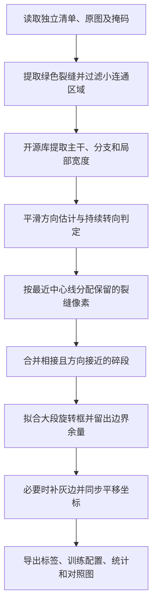

# 裂缝 OBB 数据集对比与 V2.1 生成逻辑报告

统计日期：2026 年 11 月 10 日。用途：项目复盘、简历撰写与面试说明。

本项目将已有的像素级裂缝掩码转换为 YOLO 旋转框标注。V1、V2、V2.1 使用同一批图片，主要区别在于如何定义一个检测目标：V1 按连通区域建框，V2 按中心线细分建框，V2.1 按裂缝的大段走向建框。V2.1 的目标是“每一大段一个倾斜框，只有明显转向才分割”。这三个名称是本项目的标注规则版本。

V2.1 全量生成了 12,676 个框，相比 V2 的 42,007 个框减少 69.8%，同时保持过滤后裂缝掩码的几何覆盖率为 100%。这反映了标注粒度与几何覆盖的变化，不能解释成检测准确率达到 100%。

## 一、共同的数据基础

| 项目 | 三个版本的共同设置 |
| --- | --- |
| 样本数量 | 5,462 张图像，原始图块为 512 × 512 |
| 来源分组 | 147 个来源组，按原始照片分组划分，避免同一来源跨集合 |
| 训练／验证／测试 | 3,822／818／822 张；对应来源组 84／31／32 个 |
| 检测类别 | 单类别裂缝，类别编号 0 |
| 标注输入 | 已有原图及彩色掩码；绿色 BGR `(0,128,0)` 为裂缝 |
| 其他像素 | 红色剥落区域不生成裂缝框；未知掩码颜色报错 |
| 面积过滤 | 移除面积不足 12 像素的连通区域 |
| 保留裂缝像素 | 28,623,810 个；小区域过滤共移除 1,172 个像素 |
| 输出格式 | YOLO OBB：类别编号与四个顶点的归一化坐标 |

V2、V2.1 读取独立维护的 [输入清单](D:/Code/wall_damage_identification_model/yolo/data/crack512/manifest.csv)，原图及掩码已复制到同目录的 `labelme`、`V7` 子目录。旧数据集的标签只用于画对照图，不参与新标签的计算。因此，本项目完成的是“已有分割标注到检测标注的自动转换”，不涉及从无标注照片自动识别裂缝。

## 二、三种标注规则的区别

### 2.1 规则与适用目标

| 维度 | V1：连通区域框 | V2：细分裂缝段框 | V2.1：大段走向框 |
| --- | --- | --- | --- |
| 一个目标的定义 | 一个保留的八连通区域 | 分叉或弯曲后的一小段裂缝 | 主干或可见分支中方向较稳定的大段 |
| 中心线 | 不使用 | 使用开源库提取 | 使用开源库提取 |
| 分段依据 | 不额外拆分 | 有效分叉、到首尾线段的偏离程度 | 平滑方向相对当前大段参考方向的变化 |
| 主要阈值 | 面积至少 12 像素 | 偏离阈值至少 8 像素，曲线拆分两侧弧长至少 40 像素 | 转向至少 30°、持续至少 16 像素，转角切分两侧弧长至少 64 像素 |
| 分支处理 | 连接在一起的分支可能被整体包住 | 分叉处更容易切出多个框 | 可见分支单独处理，不因主干上出现分叉就强制截断主干 |
| 轻微弯曲 | 整体拟合，框可能变宽 | 可能拆成多个细框 | 通常保留为同一个大段 |
| 框短边下限 | 2 像素 | 2 像素 | 8 像素，并在拟合后每侧留 2 像素余量 |
| 图片边界 | 逐顶点裁剪，可能破坏矩形 | 先分离贴边窄带，必要时退回水平矩形 | 给输出图片补灰边并平移标签，保留倾斜方向 |
| 主要优势 | 流程简单、目标数量少 | 能更贴合弯曲与分叉，框内背景较少 | 减少碎框，保留主要方向，符合大段裂缝检测需求 |
| 主要取舍 | 弯曲或分叉区域背景多；边界处理不够严谨 | 目标数量大、短框多；边界处理还会额外细分 | 相较 V2 框内背景增加；补边会改变训练缩放比例 |

三者没有脱离任务定义的统一优劣。V2 更偏向细粒度定位；V2.1 更符合当前需要的大段裂缝检测。不能仅凭“框更少”或“框更紧”判断标签更准确。

### 2.2 实际标签数量

| 划分 | 图片数量 | V1 框数 | V2 框数 | V2.1 框数 |
| --- | ---: | ---: | ---: | ---: |
| 训练集 | 3,822 | 6,644 | 30,606 | 8,958 |
| 验证集 | 818 | 1,387 | 5,719 | 1,828 |
| 测试集 | 822 | 1,396 | 5,682 | 1,890 |
| 合计 | 5,462 | 9,427 | 42,007 | 12,676 |
| 平均每张图的框数 | — | 1.73 | 7.69 | 2.32 |

V2.1 比 V2 少 29,331 个框，降幅为 **69.8%**；比 V1 多 34.5%，说明它保留了必要的方向切分，没有简单退回“一块区域一个框”。


### 2.3 目标尺寸与框内背景

以下尺寸按各版本自身的输出图片，将长边等比例缩放到 448 像素后估算；不包含随机训练增强和额外的步幅对齐补边。V1 的四角区域先用 `minAreaRect` 重新拟合再统计长宽。统计口径与旧 `summary.json` 中“把 V2 也放到 V2.1 补边画布上”的对照口径不同，因此个别数字会略有差别。

| 几何统计 | V1 | V2 | V2.1 |
| --- | ---: | ---: | ---: |
| 框长边中位数 | 181.57 像素 | 33.25 像素 | 136.99 像素 |
| 长边不足 16 像素的框占比 | 4.57% | 33.53% | 2.14% |
| 长边不足 32 像素的框占比 | 10.43% | 49.12% | 6.66% |
| 框短边中位数 | 18.17 像素 | 10.50 像素 | 21.02 像素 |
| 短边不足 4 像素的框占比 | 3.04% | 14.70% | 0.00% |

V2 有约三分之一的框长边不足 16 像素。V2.1 将这一占比降低到 2.14%，数据中的检测目标明显更完整。较小的目标更容易受到定位偏差影响，但当前实验未通过消融证明“短框数量”就是训练指标变化的唯一原因。

为了公平比较背景，重新读取三个版本的磁盘标签，将 V2.1 的补边坐标平移回原图，在同一原始图片范围内栅格化，按框并集统计，重叠区域不重复计数。

| 原图范围内的统计 | V1 | V2 | V2.1 |
| --- | ---: | ---: | ---: |
| 框内非保留裂缝像素总数 | 109,351,665 | 27,287,698 | 58,997,552 |
| 磁盘标签四角区域对保留掩码的覆盖率 | 92.60% | 100.00% | 100.00% |

V2.1 框内背景比 V1 少约 46.0%，但比 V2 多约 116.2%。这是减少碎框、保留大段所付出的几何取舍；不能写成“V2.1 比 V2 的框更紧”。背景像素在这里指框并集内、过滤后裂缝掩码以外的像素，包含其他类别区域及被过滤的小区域。

V1 的 92.60% 是保存的四角多边形覆盖率，不是检测召回率，也不能直接等同于训练时丢失的目标比例。本次发现其 9,427 个四角区域中，有 7,223 个在逐顶点裁剪后不再严格保持矩形正交关系。Ultralytics 加载时会再次拟合旋转矩形，实际训练区域可能与保存的四边形不同。这也说明边界处理需要显式保持几何一致性。

### 2.4 同一图片的直观对照

`IMG_6637_35`：V1 为 3 个框，V2 为 10 个框，V2.1 为 5 个框。V2.1 保留上方独立裂缝、左下分支及主裂缝的主要方向段，贴边处保持倾斜矩形。


另外两张例子：[复杂分叉 IMG_6926_50，8／25／11 个框](D:/Code/wall_damage_identification_model/yolo/reports/crack_obb_dataset_comparison_v21/images/IMG_6926_50_three_versions.jpg)；[长对角裂缝 IMG_8010_50，1／10／1 个框](D:/Code/wall_damage_identification_model/yolo/reports/crack_obb_dataset_comparison_v21/images/IMG_8010_50_three_versions.jpg)。

## 三、V2.1 的主要生成逻辑

核心实现位于 [prepare_crack_obb_v2.py](D:/Code/wall_damage_identification_model/yolo/prepare/prepare_crack_obb_v2.py)。文件名沿用 V2，实际通过 `--profile relaxed` 选择 V2.1，直接从原始掩码计算完整标签并创建输出结构。



### 3.1 提取裂缝，并保留可靠的数据划分

读取输入清单，检查样本输出名不重复，来源组不能跨训练、验证、测试集合。将绿色掩码转换为二值图，计算八连通区域，过滤不足 12 像素的区域。

这一过程保留原始的集合划分，没有把同一原始照片的图块重新随机混入不同集合。后续分段在每个原始连通区域内部进行，不跨不连通区域合并。

### 3.2 复用开源中心线提取能力

调用 `fine-crack-tracing` 的 `trace`，使用骨架模式提取中心线路径、主干、分支及局部宽度。当前固定上游版本为 1.0.0、提交 `da32dd1ae80f2b6b1a58758033b183e16b6259a2`，保留 MIT 许可证。

本项目关闭断裂桥接与填洞：`bridge=False`、`fill_holes=0`。骨架毛刺剪枝只改变用于引导分段的路径，不直接删除已经保留的裂缝掩码像素。短分支若不足 `max(24 像素, 3 × 局部中位宽度)`，不单独建立路径，但其掩码像素仍参加后续分配。

### 3.3 按明显转向切分大段

对应函数：[relaxed_path_pieces](D:/Code/wall_damage_identification_model/yolo/prepare/prepare_crack_obb_v2.py:149) 与 [split_by_angle](D:/Code/wall_damage_identification_model/yolo/prepare/prepare_crack_obb_v2.py:163)。

1. 沿中心线弧长每 2 像素重新采样，避免原始点密度影响判断。
2. 用前后共 48 像素的邻域估计局部走向，降低锯齿和局部小波动的影响。
3. 用当前大段起点之后一段稳定区间的方向中位数作为参考方向。
4. 计算局部方向与参考方向的夹角差；达到 30°，且持续至少 16 像素，才确认发生明显转向。
5. 确认切分时，从持续转向开始的位置截断，并重新建立下一大段的参考方向。
6. 转角切分要求两侧弧长至少 64 像素，防止大转角附近产生很短的框。

这里比较的是“相对当前大段的方向变化”，不是相邻两个中心线点的瞬时角度；所以多个很小的转向持续累积后，也可能构成需要切分的弯曲。64 像素限制用于路径内部的再切分，真实存在的短裂缝或独立短分支不会因此被全部删除。

阈值是结合当前图块尺度和可视化样例确定的工程参数，尚未通过系统消融证明为最优值。V2.1 使用 `--split-angle`，不使用旧 V2 的 `--max-deviation`；配置中保留的 `max_deviation`、`width_tolerance` 字段不会驱动 V2.1 的切分。

### 3.4 将真实裂缝像素分配回各段

对应函数：[convert_binary](D:/Code/wall_damage_identification_model/yolo/prepare/prepare_crack_obb_v2.py:361)。

中心线负责决定裂缝怎样分段，框的大小则由真实掩码像素决定。程序在同一连通区域内，把各段中心线点加入 SciPy `cKDTree`，按最近中心线给每个裂缝像素分配所属段。

若某段分配到的像素不足 12 个，将这些像素重新分配给附近的有效段；若一个连通区域没有可用中心线，则用该区域整体拟合。这样，忽略短毛刺作为分段依据时，其实际裂缝像素仍得到保留。

### 3.5 合并相邻、方向相近的碎段

对应函数：[merge_pixel_groups](D:/Code/wall_damage_identification_model/yolo/prepare/prepare_crack_obb_v2.py:220)。

只在同一个原始连通区域内建立像素相接的段之间的邻接关系。普通段需要方向差不超过 25°，并满足：

`合并后旋转框面积 ÷ 两个原旋转框面积之和 ≤ 1.35`

若其中一段长边不足 32 像素，则允许优先处理该碎段，面积比上限放宽到 1.8，并放宽方向限制。这里比较的是无朝向的矩形轴线，方向相差 180°视为同一轴线。

合并过程保留参与段的全部像素；面积约束用于避免把明显分叉重新装入过大的框。它是带约束的贪心合并，没有求解全局最优分段。

### 3.6 按全部分配像素拟合倾斜框

对应函数：[fit_directional_box](D:/Code/wall_damage_identification_model/yolo/prepare/prepare_crack_obb_v2.py:276)。

对每段的全部裂缝像素中心执行 OpenCV `minAreaRect`，得到最小面积旋转矩形。随后把覆盖范围从像素中心扩展到像素边界，每侧再留 2 像素余量，并保证短边至少 8 像素。

因此，旋转框的方向来自该段裂缝的整体几何分布；接近水平或竖直的裂缝依然可能得到接近水平或竖直的框。增加框宽是检测标注的工程处理，不能把旋转框短边当作真实裂缝宽度测量值。

### 3.7 贴边时补图，保留倾斜方向

对应函数：[pad_for_boxes](D:/Code/wall_damage_identification_model/yolo/prepare/prepare_crack_obb_v2.py:286)。

如果倾斜框角点落在原图之外，计算容纳全部框所需的左、上、右、下补边量，只给输出图片副本增加 RGB `(114,114,114)` 灰边，并同步平移框和预览坐标。框不改成水平矩形，也不会仅因贴边就被拆碎。

完整 V2.1 中有 5,339 张图片发生补边，单侧最多 80 像素。原图文件不修改，但输出图片尺寸可能大于 512；同样缩放到网络输入尺寸时，原图区域的有效分辨率会略低。

导出四角时使用补边后的宽高归一化：`x' = (x + 左补边) / 新宽度`，`y' = (y + 上补边) / 新高度`。逐图补边量及原始、输出尺寸保存在生成清单中。

### 3.8 直接导出完整数据集

按照原有划分直接写入 `images`、`labels`、`data.yaml`、逐图清单和汇总结果。完整数据均输出，默认仅为 36 张代表样本额外保存对照图和中心线调试文件，避免产生几千份调试文件。

本次全量生成使用的参数为 `--full --profile relaxed --split-angle 30`，输出到 [V2.1 数据集目录](D:/Code/wall_damage_identification_model/yolo/data/crack_obb_auto_v21)。这不是复制预览标签组成的新数据集；每张图的标签都由源掩码重新计算。现有非空目录会拒绝覆盖，重新生成时需要指定新输出目录。

主要流程可概括为以下伪代码：

```text
读取独立清单，并检查来源组划分
对每张图：
    提取绿色裂缝，过滤面积不足 12 像素的区域
    调用开源库提取中心线、主干及分支
    对各路径估计平滑方向，按持续的大转向切分
    在每个连通区域内，将保留像素分配给最近的中心线段
    合并相接且符合方向、面积约束的段
    对每段全部像素拟合旋转矩形并增加边界余量
    如有角点越界，则给输出图片补边并平移所有相关坐标
    按输出图片尺寸归一化，保存图片及 YOLO OBB 标签
输出完整统计、训练配置和抽样可视化
```

## 四、项目实现、开源复用与质量检查

### 4.1 简历中可以归纳的实现工作

| 内容 | 实际来源与项目工作 |
| --- | --- |
| 骨架化、中心线、主干与分支、局部宽度 | 复用开源 `fine-crack-tracing`，固定版本并保留许可证 |
| 最小面积旋转矩形与连通区域计算 | 调用 OpenCV 的通用算法接口 |
| 最近邻搜索 | 调用 SciPy `cKDTree`，本项目规定同区域内的像素分配方式 |
| 持续转向切分 | 本项目新增，包含平滑方向、参考方向、持续距离与最短弧长约束 |
| 相邻段合并 | 本项目新增，结合像素邻接、方向差、面积增长约束和短段优先处理 |
| 像素覆盖与边界处理 | 本项目实现，包含小段像素重分配、像素边界扩展、补边及坐标同步 |
| 数据工程 | 本项目实现，包含独立清单、来源分组检查、YOLO 导出、逐图统计与可视化追溯 |

本项目的贡献可以表述为“针对裂缝检测任务设计并实现分段标注策略与数据转换流程”。现有证据不支持将它表述为从零研发中心线算法，或具有学术首创性的全新检测算法。

### 4.2 已完成的检查

- 具有 25 项合成几何单元测试，覆盖直线、弯曲、分叉、贴边、短毛刺、独立小裂缝、颜色与源文件等场景；当前转换规则已通过测试。
- 全量检查 5,462 张图的图片与标签对应关系、归一化坐标范围、矩形几何、重复标签及缺失文件。
- 标签写入并重新读取后，保留的 28,623,810 个裂缝像素覆盖率为 100%；不足面积阈值的 1,172 个像素单独记录。
- 147 个来源组没有跨训练、验证、测试集合。
- 三个集合均通过 Ultralytics OBB 数据集加载及样例批次检查。
- 完整数据中对应的 36 张预览标签，与用户认可的预览结果逐字一致。

检查详情见 [V2.1 全量校验报告](D:/Code/wall_damage_identification_model/yolo/data/crack_obb_auto_v21/validation.json)。这些检查证明格式、对应关系和几何覆盖符合当前规则，不能代替人工确认每一处目标粒度是否合理。

### 4.3 验证拼图漏显示问题的定位

最新验证中，`IMG_8010_50` 有 1 个有效标签，但 Ultralytics 绘图函数把内部归一化长边 `1.172` 误判为像素值。合法的倾斜矩形长边可以大于图片宽度；这个问题发生在坐标单位的自动判断中。

已在 [val_crack_obb.py](D:/Code/wall_damage_identification_model/yolo/scripts/val_crack_obb.py:14) 中增加绘图专用处理，将标签副本明确换算成像素坐标。没有修改用于计算的批次标签，并验证该图仍有 1 个目标进入验证和损失预处理。原始标签、权重及既有验证指标未因绘图修复改变。排查记录见 [绘图问题诊断](D:/Code/wall_damage_identification_model/yolo/output/val-7/fixed_labels/diagnosis.json)。

## 五、现有训练结果及其解释范围

### 5.1 三组训练日志中的结果

选取相同的 YOLO26n OBB、输入尺寸 448、批大小 8 的三组实验。三组均有 100 轮训练记录。下表取各自训练日志中 mAP50–95 最高的一轮，mAP50 也取同一轮，不把不同轮次的最优数字拼在一起。

| 标签版本 | 对应实验 | 选中轮次 | mAP50 | mAP50–95 |
| --- | --- | ---: | ---: | ---: |
| V1 | `crack_yolo26n_448` | 98 | 57.20% | 29.94% |
| V2 | `crack_yolo26n_448_v2` | 79 | 45.30% | 19.05% |
| V2.1 | `crack_yolo26n_448_v21` | 74 | 67.22% | 34.81% |

这是各自标签定义下的描述性结果。三版验证目标的数量、粒度和几何范围不同；V1 的配置还记录了断点恢复。因此，该表不能视为仅改变标注算法的严格受控实验，也不能直接把差值写成“检测精度提升了若干个百分点”。当前结果与 V2.1 更符合大段目标的设计意图一致，但不能证明单一改动的因果收益。

### 5.2 V2.1 最新一次单独验证

最新单独验证记录来自 [验证指标文件](D:/Code/wall_damage_identification_model/yolo/output/val_metrics.txt) 及 `output/val-7`，当前验证入口使用 V2.1 的最佳权重。原始指标按 2026 年 11 月 10 日保存到本报告目录的 [训练与验证快照](D:/Code/wall_damage_identification_model/yolo/reports/crack_obb_dataset_comparison_v21/training_snapshot.json)。

| 指标 | 结果 |
| --- | ---: |
| 精确率 P | 67.21% |
| 召回率 R | 63.79% |
| mAP50 | 67.21% |
| mAP50–95 | 34.88% |

验证集共有 818 张图，其中 813 张有裂缝标签、5 张为空标签；类别统计表中的 813 对应含该类目标的图片数。验证目标共 1,828 个。以上是验证集结果，尚不能写成独立测试集成绩或实际部署效果。

单独验证和训练日志的结果来自两次执行，数值略有不同，应分别记录。简历若引用最新验证，建议统一使用“mAP50 67.21%、mAP50–95 34.88%”，并明确属于 V2.1 验证集。

如需证明分段策略带来检测能力提升，下一步应先固定一套符合最终任务定义的人工审核评测标签，再比较不同训练方案；同时固定模型、初始化、训练预算与输入设置，并对转向阈值、合并规则、框宽余量和补边分别做消融。当前报告没有把这些尚未完成的实验列为成果。

## 六、可用于简历的项目表述

### 6.1 推荐项目名称

**墙面裂缝旋转目标检测与自动标注数据构建**

技术栈：Python、OpenCV、NumPy、SciPy、PyTorch、Ultralytics YOLO、fine-crack-tracing。

### 6.2 简历三条版

- 基于 OpenCV 与开源中心线提取库构建裂缝掩码到 YOLO OBB 的自动转换流程，完成 5,462 张图像、147 个来源组的数据整理与划分，生成 12,676 个大段裂缝旋转框。
- 针对细分标注中的碎框问题，设计持续转向判定、最短弧长约束与邻接段合并策略，相比细分版本减少 69.8% 的标注框，并保持过滤后裂缝掩码像素覆盖率 100%。
- 实现旋转框补边、坐标同步、标签校验与可视化追溯，完成 YOLO26n OBB 训练，在该版本验证集上取得 mAP50 67.21%、mAP50–95 34.88%。

### 6.3 简历篇幅较短时

基于开源中心线提取与 OpenCV 构建裂缝掩码到旋转框的自动转换流程，设计持续转向切分及邻接段合并策略，处理 5,462 张图像并生成 12,676 个大段标注框，较细分版本减少框数 69.8%，保持过滤后掩码像素覆盖率 100%；完成 YOLO26n OBB 训练，验证集 mAP50 达 67.21%。

### 6.4 面试时的一分钟说明

> 原始数据有像素级裂缝掩码，但需要用于旋转框检测。我先比较了三种目标定义：按连通区域整体建框时，弯曲和分叉区域会包含较多背景；按中心线细分时，又产生了大量短框。于是我基于开源库提取的中心线，增加了平滑方向和持续转向判断，让方向相对稳定的裂缝保持为一个大段，只在明显转弯处切开，再结合邻接关系和面积增长约束合并碎段。框由实际掩码像素拟合，贴边时通过补图和坐标平移保留倾斜方向。最终把细分版本的 42,007 个框减少到 12,676 个，保留掩码像素的几何覆盖率仍是 100%，并完成了格式校验、可视化和 YOLO 训练验证。中心线提取复用了开源实现，项目重点是面向检测任务的分段策略和数据处理流程。

### 6.5 容易被追问的细节

| 问题 | 应能说明的内容 |
| --- | --- |
| 为什么不是一个连通区域一个框？ | 连通性不代表方向一致，分叉或弯曲会使整体框包含较多背景。 |
| 为什么也不能无限细分？ | 检测目标定义会改变，短框数量增加；需要根据业务粒度在贴合程度与目标完整性之间取舍。 |
| 为什么 30° 不会被噪声轻易触发？ | 使用 48 像素邻域估计方向，并要求偏转持续 16 像素，同时施加切分两侧最短弧长约束。 |
| 64 像素会不会删除短裂缝？ | 它限制转角切分的位置，不是删除所有短于 64 像素的目标。 |
| 如何保证不漏掉被忽略的毛刺像素？ | 骨架与掩码分开处理，毛刺不单独建路径时，其保留像素仍按最近中心线分配。 |
| 100% 到底指什么？ | 过滤后掩码像素都落在框并集内，属于几何覆盖，不等于标注精度或模型召回率。 |
| 为什么不直接裁剪倾斜框的顶点？ | 独立裁点可能破坏矩形；补边和平移能同时保留方向、矩形与像素覆盖。 |
| 为什么 V2.1 背景反而比 V2 多？ | V2.1 的目标更完整、框更宽，这是减少碎框的代价，不是所有几何指标同时变好。 |
| 哪些不是自己从零实现的？ | 中心线与图结构复用 fine-crack-tracing，矩形拟合用 OpenCV，最近邻用 SciPy。 |

## 七、报告文件与统计口径

本次报告及新增统计脚本均位于独立的 `reports` 目录，没有把报告文件放进 `prepare`。

| 文件 | 用途 |
| --- | --- |
| [统计脚本](D:/Code/wall_damage_identification_model/yolo/reports/crack_obb_dataset_comparison_v21/compare_datasets.py) | 只读三个版本的磁盘标签，计算几何统计并生成对照图 |
| [完整统计](D:/Code/wall_damage_identification_model/yolo/reports/crack_obb_dataset_comparison_v21/statistics.json) | 本报告数量、尺寸、覆盖和背景数据的来源 |
| [逐图对照表](D:/Code/wall_damage_identification_model/yolo/reports/crack_obb_dataset_comparison_v21/per_image_geometry.csv) | 5,462 张图片逐图框数、覆盖率与背景像素 |
| [训练与验证快照](D:/Code/wall_damage_identification_model/yolo/reports/crack_obb_dataset_comparison_v21/training_snapshot.json) | 保存本报告引用的实验目录、选中轮次和原始指标 |
| [V1 规则实现参考](D:/Code/wall_damage_identification_model/yolo/prepare/prepare_crack_obb.py:40) | 连通区域与轮廓矩形拟合；保留旧路径假定，复用前需重新配置路径 |
| [V2／V2.1 转换入口](D:/Code/wall_damage_identification_model/yolo/prepare/prepare_crack_obb_v2.py:614) | 实际使用的完整生成脚本 |
| [开源版本记录](D:/Code/wall_damage_identification_model/yolo/prepare/vendor/fine_crack_tracing/UPSTREAM.json) | 中心线库版本、提交及许可证 |

统计说明：框数来自实际标签文件；覆盖与背景在共同原图范围内统计，V2.1 先扣除坐标平移，补边区域不计入背景；尺寸统计按各版本自身输出尺寸估算缩放。V1 四角不正交的判定使用相邻边夹角余弦绝对值大于 0.001 或退化边，属于保存多边形的几何检查。所有版本的标签和掩码均只读，没有因本次报告重新生成或修改训练数据。
